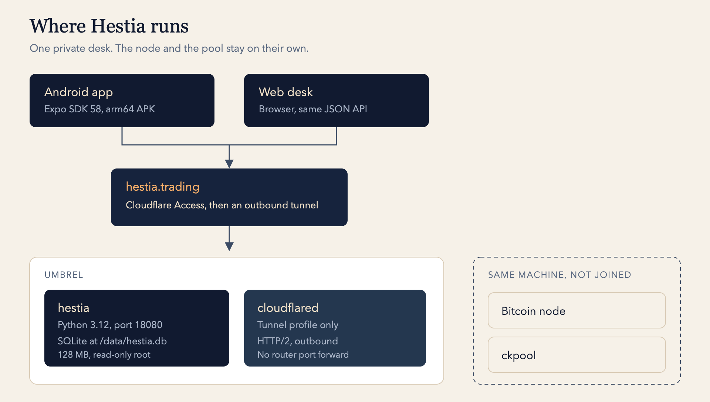
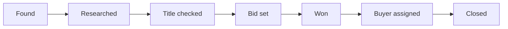
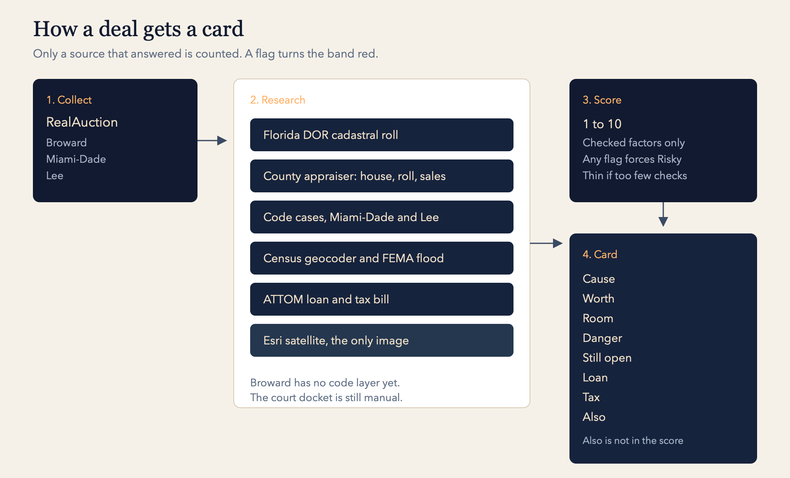
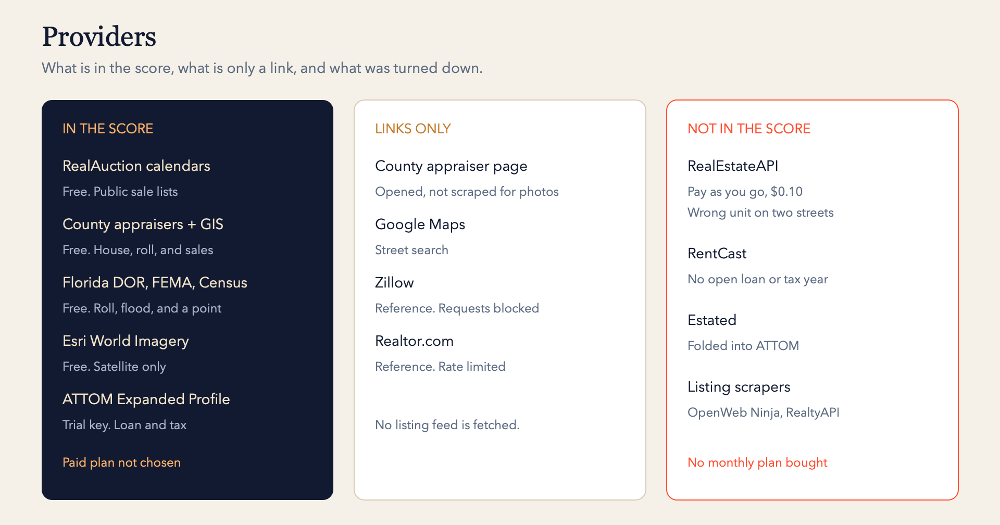

# Stack, providers, and plans

Hestia is a one-person desk for Broward, Miami-Dade, and Lee auction sales. This page is the map of what it runs on, what it pays for, and what it refused.

The Android app and the web desk both talk to one Python server. Cloudflare Access sits in front of `hestia.trading`. The tunnel is outbound only, so the home router has no port forward for this app. On the Umbrel, the `hestia` container is capped at a quarter CPU and 128 MB, its root filesystem is read-only, and its only disk is `data/hestia.db`. The Bitcoin node and ckpool are on that machine and are not on this network.

## Tech stack

| Layer | What it is |
| --- | --- |
| Server | Python 3.12, standard library only. `ThreadingHTTPServer` in `app.py`. No web framework. |
| Desk | Static HTML, `static/desk.css`, `static/desk.js`. EB Garamond is a file in the repo, not a font host. |
| Data | One SQLite file, `HESTIA_DB` (`/data/hestia.db` in the container). |
| Host | Docker Compose project `hestia` on the Umbrel. Image `python:3.12-slim`. |
| Edge | `cloudflare/cloudflared`, Compose profile `tunnel`, HTTP/2. Cloudflare Access on the hostname. |
| Phone | Expo SDK 58, React Native 0.88, Expo Router. Package `com.hestia.trading`. |
| Phone updates | EAS Update on the `production` channel. The installed APK is arm64. A native rebuild is only for a native module change. |
| Tests | `python3 -m unittest test_deals` |
| Ship | `./deploy.sh` tests, syncs the app files, rebuilds the hestia container, and publishes an over-the-air update when `mobile/` changed. |

Sale days are America/New_York. The Umbrel clock is not the sale clock.

Passed sits beside that line. Hestia fills Found and Researched. Title checked is the docket and the lien search. Bid set is the ceiling. The county site still places the bid.

## How a deal gets a card

The score uses only factors a source actually answered. Each checked factor can earn 0, 1, or 2. The number is `round(1 + 9 × earned / possible)`, and possible is 2 times the number of checked factors. Version 3 of the rules lives in `diligence.py`.

| Band | When |
| --- | --- |
| Excellent | Score at least 8, and the operator recorded a lien search. ATTOM answering the loan line is not that search. |
| Good | Score at least 6, and no flag. A strong paper score stays Good until that lien search. |
| Fair | Score 4 or 5, and no flag. |
| Risky | Any flag, or a score of 3 or less. |
| Not enough data | The house number disagrees across sources, resale has fewer than two sources, or fewer than four factors were checked. |

On the sky map the bands are blue, green, yellow, red, and a hollow dot. Amber on the card marks danger, a tax line that starts with Delinquent, or a cause that is an HOA lien or more than one thing. A tax deed is not red just because the taxes are delinquent. That is why it is in the sale. An HOA case in county court is red. Delinquent taxes on a foreclosure, or a second loan on a foreclosure, are red.

The cause is read from the auction type, the court in the case number, and the ATTOM tax line.

| What the list shows | Cause |
| --- | --- |
| Tax deed | Taxes |
| County court, taxes delinquent | Taxes and HOA lien |
| Circuit court, taxes delinquent | Taxes and mortgage |
| County court only | HOA lien |
| Circuit court only | Mortgage |
| Delinquent taxes, court not readable | Taxes |

County-court case numbers are the ones Hestia can see as COCE, CONO, COSO, COWE, or a county-court marker. Circuit numbers are CACE or a CA marker. An HOA suit filed in circuit court still reads as Mortgage until the docket is opened.

The card, in order: Cause, Worth, Room, Danger, Still open, then Loan and Tax when ATTOM returned them. Worth is whether a sale since 2023 agrees with the roll. Room is how many times the roll covers the bid. Danger is the first flag, or "None on record." Still open is whatever no source answered, plus the court docket until it is checked, plus other liens until that search is done. The seven factors stay behind the card: resale value, comparables, title, code and building, flood, occupancy, and other liens.

## Providers in the score

| Provider | Plan | What Hestia takes |
| --- | --- | --- |
| RealAuction | Free public calendars | Broward tax deeds and foreclosures, Miami-Dade (both on one calendar), Lee tax deeds and foreclosures. Opening bid, or the final judgment on a foreclosure. |
| County appraisers | Free | Broward `bcpa.net`, Miami-Dade PaParcelView, Lee parcel GIS. House line, just value, homestead, sales. |
| Florida Department of Revenue | Free cadastral service | Statewide just value, homestead, last sale, and a point. |
| Miami-Dade and Lee code GIS | Free | Open code cases, code liens, building violations, Lee nuisance cases. Broward has no code layer here, so that factor stays unchecked. |
| US Census geocoder | Free | A second address and a point when the roll has none. |
| FEMA flood map | Free | Zone. Coastal V zones raise a flag. |
| Esri World Imagery | Free | The satellite on the card. There is no street-photo feed. |
| ATTOM Property API | Trial key, no paid plan chosen | Expanded Profile. Open first loan, a second loan amount when present, tax bill, and delinquent year. One call per address. Judgments and the docket are not in this report. |

The ATTOM key is `ATTOM_API_KEY` in `~/hestia/.env` on the Umbrel, passed into the container by Compose. The value is not in git.

Street links on the card open the county appraiser, Google Maps, Zillow, and Realtor.com. Those pages are not fetched. Zillow refused automated requests and Realtor rate-limited them. County photo pages are not scraped.

## Plans that were not bought

The comparison was about a second loan-and-tax source, not a replacement for the county rolls.

| Vendor | Published offer | Decision |
| --- | --- | --- |
| RealEstateAPI pay as you go | $0.10 per property record, no minimum, no autocomplete. A $200 credit is in use. | Pulled for the current sale list. The Also line on the card shows it. The score still uses ATTOM. A street match often returned a different unit, so the pull prefers the county parcel id. |
| RealEstateAPI Starter | $599 a month, 30,000 credits. The published price assumes an annual term. | Not bought. |
| RealEstateAPI Growth | $1,200 a month, 150,000 credits | Not bought. |
| RealEstateAPI Pro | $2,500 a month, 400,000 credits | Not bought. |
| RealEstateAPI Enterprise | Contact sales | Not contacted. |
| RealEstateAPI free trial | $200 of credits, 14 days, no card. It does not turn into the $599 plan by itself. | This is the credit in use. |
| ATTOM after the trial | No public self-serve price was chosen | Still on the trial key. |
| RentCast | A small monthly plan, and 50 free calls a month | Not used. It does not return an open loan or a delinquent year, and 50 calls is smaller than one sale list. |
| Estated | Old free-credit offer | Not available to new customers. ATTOM acquired it in 2022. |
| OpenWeb Ninja, RealtyAPI | Listing-scrape plans | Not used. Wrong dataset. |

RealEstateAPI extras that were not turned on, because they cost more: comparable sales, skip trace, and involuntary liens. Property Search count calls also spend a credit on pay as you go, so those were not used either.

`REALESTATE_API_KEY` is in the Umbrel container. A rescore does not call RealEstateAPI again. The Also line is the stored report.

## What is still by hand

Clerk sites sit behind captchas and are not bypassed. The docket, judgments, and association liens outside the case-number guess stay on the Title checked step. Condo units often miss the county house line. A Lee row whose parcel text is the words "Property Appraiser" cannot be looked up. Hestia does not bid, does not email buyers, and does not store a buyer list yet. That work is in [FEATURES.md](../FEATURES.md).
